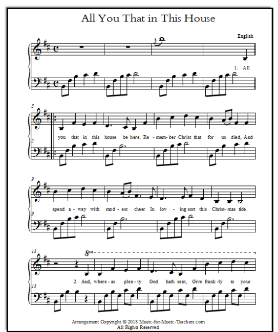

# Precision Neural Optical Music Recognition (OMR) & Audio Player

A 100% local, high-precision Optical Music Recognition system and interactive web player. Converts scanned sheet music and PDF documents into editable MusicXML, playable multi-instrument polyphonic audio (WAV), and Standard MIDI files — with **zero cloud dependencies** and **no API keys**.



---

## Key Features

1. **Precision Neural OMR (TrOMR + SegNet)**
   - Utilizes `homr`'s hybrid SegNet staff/symbol segmentation and Transformer-based End-to-End sequence recognition.
   - Resolves key signatures, time signatures, clefs, notes, accidentals, ties, rests, and measures with pitch & rhythm accuracy.

2. **Original Sheet Layout Preservation**
   - Automatically preserves original system breaks and line formatting (`<print new-system="yes"/>`).
   - The rendered score maintains the exact measure layout and staves per row as printed in the original source sheet.

3. **Multi-Instrument Audio Synthesis**
   - Built-in multi-timbre additive audio synthesizer with instrument-specific ADSR envelope modeling:
     - 🎹 **Acoustic Grand Piano**: Hammer strike attack with percussive exponential decay.
     - ⛪ **Pipe / Church Organ**: Multi-rank pipe harmonic mixture with sustained plenum.
     - 🎻 **String Ensemble**: Bowed strings with lush vibrato and warm sawtooth spectrum.
     - 🪈 **Concert Flute**: Pure breathy woodwind with expressive vibrato.
     - ⚡ **Electric Piano**: Rhodes-style bell-tine attack with warm sustain.
     - ✨ **Music Box / Celesta**: Bright inharmonic metallic chimes with ringing decay.
     - 👾 **8-Bit Chiptune**: Retro square / pulse wave synthesis.

4. **Multi-Format Input & Async Processing**
   - Supports **PDF documents** (rendered to crisp 300-DPI via `pypdfium2` without external Poppler binaries) and images (**PNG, JPG, WEBP**).
   - Real-time asynchronous progress reporting (0% to 100%) showing segmentation, dewarping, transformer inference, and synthesis stages.

5. **Interactive Notation & Vector Engraving**
   - Vector sheet rendering powered by [OpenSheetMusicDisplay](https://opensheetmusicdisplay.org/) (OSMD).
   - Interactive zoom controls, responsive SVG scaling, and one-click downloads for WAV, MIDI, and MusicXML.

---

## Project Structure

```text
MusicNoteReader/
├── server/
│   ├── app.py              # FastAPI application & REST endpoints
│   ├── omr_engine.py       # Asynchronous job worker & PDF rasterization
│   └── synthesizer.py      # Multi-instrument WAV & MIDI synthesizer
├── static/
│   ├── index.html          # Clean, modern single-page player UI
│   ├── app.css             # Glassmorphic dark theme styles
│   └── app.js              # Client controller, OSMD setup & audio player
├── samples/                # Benchmark and demo sheet music images
│   ├── all_you_that_in_this_house.png
│   ├── song01.png
│   └── sample_sheet.png
├── OMR-Background.md       # Literature review, OMR theory, and benchmarking notes
├── .gitignore              # Ignores venvs, runtime jobs, and archived spikes
├── README.md               # Project documentation
├── storage/                # [Gitignored] Runtime job artifacts (XML, WAV, MIDI)
└── archive/                # [Gitignored] Deprecated scripts & exploratory spikes
```

---

## Installation & Requirements

### Prerequisites
- Python 3.10 – 3.12
- [uv](https://github.com/astral-sh/uv) (recommended) or standard Python `venv`

### Setup

```bash
# Clone the repository
git clone <repo-url>
cd MusicNoteReader

# Create and activate a virtual environment
uv venv
# On Windows PowerShell:
.venv\Scripts\Activate.ps1
# On Linux / macOS:
source .venv/bin/activate

# Install core dependencies
uv pip install homr onnxruntime pypdfium2 fastapi uvicorn numpy
```

---

## Running the Application

Start the local server with Uvicorn:

```bash
python -m uvicorn server.app:app --host 127.0.0.1 --port 8080 --reload
```

Open your browser at:
```
http://127.0.0.1:8080
```

---

## API Reference

| Endpoint | Method | Description |
| :--- | :---: | :--- |
| `/api/omr/upload` | `POST` | Uploads a PDF or Image; allocates a background job ID. |
| `/api/omr/sample/{sample_name}` | `POST` | Queues a bundled demo sheet (`all_you_that`, `song01`, `sample_sheet`). |
| `/api/omr/jobs/{job_id}` | `GET` | Polls real-time progress (`progress`, `stage`, `status`, `result`). |
| `/api/omr/jobs/{job_id}/musicxml` | `GET` | Streams the transcribed MusicXML file. |
| `/api/omr/jobs/{job_id}/audio.wav?instrument={inst}` | `GET` | Streams synthesized audio in the selected instrument timbre. |
| `/api/omr/jobs/{job_id}/audio.mid?instrument={inst}` | `GET` | Streams standard Type-0 MIDI with the instrument's GM program. |

Supported instruments for `?instrument=`:
`piano` (default), `organ`, `strings`, `flute`, `epiano`, `music_box`, `chiptune`.

---

## Background & OMR Methodology

For an in-depth survey of Optical Music Recognition paradigms (traditional pipeline vs. modern deep learning TrOMR models) and benchmark comparisons, consult [OMR-Background.md](OMR-Background.md).
